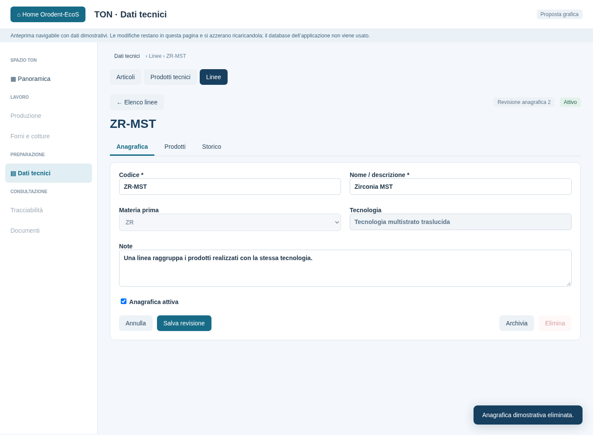
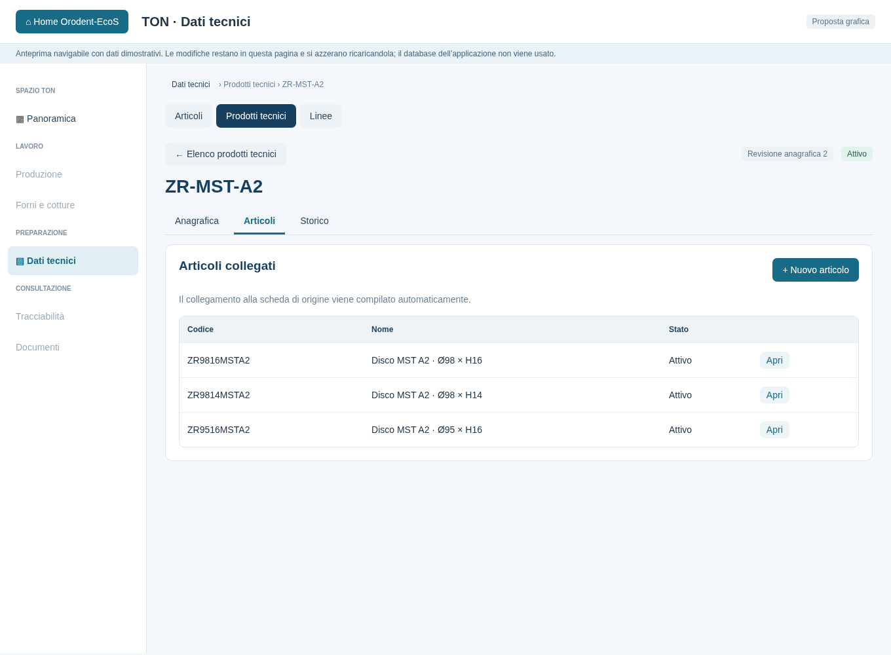
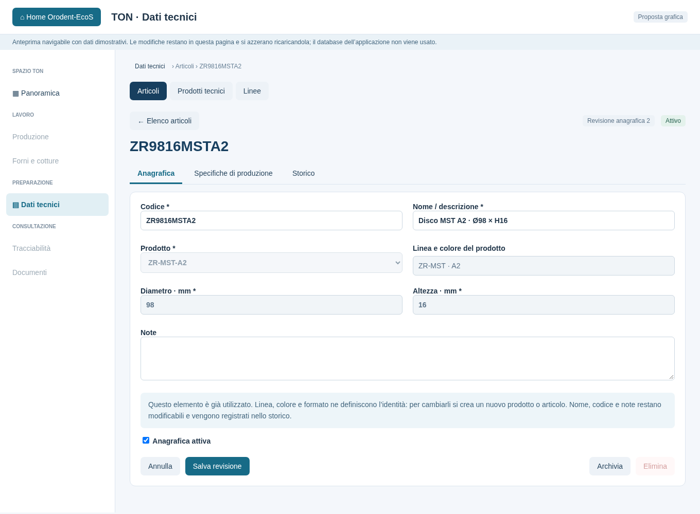

# Proposta: Linee, Prodotti tecnici e Articoli

Stato: **cataloghi implementati con schema V6**. Vedere la
[guida della versione effettiva](ton-cataloghi.md).
L'[anteprima HTML originale](mockups/ton-cataloghi.html) resta un riferimento
navigabile con dati dimostrativi, senza accesso al DB dell'applicazione.
I [modelli disco](ton-modelli-disco.md) e le [composizioni](ton-composizioni.md)
sono operativi. Le versioni approvate si usano dentro Articoli.

Le sezioni seguenti conservano il disegno concordato; i dettagli d'uso correnti,
le regole della migrazione e i limiti operativi sono nella guida.

## Accessi e gerarchia

| Sinistra | Destra |
| --- | --- |
| Articoli | Composizioni |
| Prodotti tecnici | Modelli disco |
| Linee | Polveri |

La gerarchia dei dati è **Linea → Prodotto → Articolo**:

- **Linea**: una tecnologia del laboratorio.
- **Prodotto**: una combinazione di linea e colore commerciale.
- **Articolo**: il prodotto in un formato, identificato da diametro e altezza.

Esempio illustrativo: linea ZR · MST, prodotto ZR · MST · A2, articoli
ZR9814MSTA2, ZR9816MSTA2 e ZR9516MSTA2. Il prodotto raggruppa i tre formati.
Il colore A2 è una tinta del prodotto, distinta da Bianca/Gialla/Rosa/Grigia delle polveri.
Un articolo mostra linea, colore, diametro e altezza; nel DB linea e colore
derivano dal prodotto collegato, per evitare dati contraddittori.

## Struttura comune delle schermate

Elenco a tutta larghezza con ricerca, filtri, stato attivo/archiviato e pulsante
Nuovo. **Apri scheda** passa a un editor a tutta larghezza coerente con Polveri.
Il ritorno mantiene filtri e pagina; una selezione non sostituisce l'editor.
Le schede collegate permettono di scendere nella gerarchia e creare il figlio
con il padre già selezionato.

### Linee

Elenco: codice, nome/tecnologia, eventuale materia prima, numero prodotti e stato.

- **Anagrafica**: codice, nome, tecnologia, eventuale materia prima, note e stato.
- **Prodotti**: prodotti della linea, colore, numero articoli, apertura della
  scheda e **Nuovo prodotto per questa linea**.
- **Storico**: revisioni con data, valori precedenti e campi modificati.

Una linea già utilizzata non deve cambiare significato tecnologico: una tecnologia
diversa richiede una nuova linea. Correzioni descrittive restano possibili.

### Prodotti tecnici

Elenco: codice, linea, colore commerciale, numero articoli e stato. Filtro per linea.

- **Anagrafica**: codice, nome/descrizione, linea, colore commerciale, note e stato.
  Il colore prevede un valore esplicito **Senza colore**.
- **Articoli**: formati collegati, stato della configurazione produttiva,
  apertura della scheda e **Nuovo articolo per questo prodotto**.
- **Storico**: revisioni e variazioni dei dati.

Non si duplicano combinazioni linea/colore. Se il prodotto è già utilizzato,
spostarlo in un'altra linea o cambiarne colore significa creare un nuovo prodotto;
nome, codice e note possono essere corretti conservando lo storico.

### Articoli

Elenco: codice articolo, linea, colore, diametro, altezza, specifica produttiva
predefinita e stato. Filtri per linea, prodotto, diametro e altezza; l'anteprima
mostra il filtro prodotto, gli altri verranno aggiunti all'implementazione.

- **Anagrafica**: codice, descrizione, prodotto, linea/colore ereditati in sola
  lettura, diametro, altezza, note e stato.
- **Specifiche di produzione**: composizione e modello con le loro versioni
  precise, stato Bozza/Approvata/Ritirata e scelta della versione predefinita.
  Le configurazioni restano qui, senza un quarto catalogo principale.
- **Storico**: revisioni anagrafiche, separate dalle versioni produttive.

Si può registrare l'articolo prima di avere composizione e modello: è **Da
configurare** e non è ancora producibile. L'approvazione produttiva richiederà
composizione e modello approvati e compatibili con prodotto e formato; i relativi
cataloghi saranno realizzati successivamente.

Non si duplicano combinazioni prodotto/diametro/altezza. Dopo l'utilizzo, cambiare
prodotto, diametro o altezza identifica un articolo diverso: Duplica potrà
velocizzarne la creazione senza alterare le produzioni precedenti.

## Modifiche, eliminazione e versionamento

Il contatore versione_modifica oggi protegge dalle sovrascritture concorrenti:
**non è uno storico**. La proposta introduce revisioni reali delle tre anagrafiche.

- Ogni salvataggio effettivo conserva valori completi e data nella stessa
  transazione. Lo storico è consultabile.
- Le specifiche produttive hanno inoltre il ciclo Bozza → Approvata → Ritirata:
  una versione approvata si consulta e si copia in una nuova bozza.
- Approvando una configurazione si conservano i riferimenti alle revisioni
  anagrafiche coinvolte. Produzioni e documenti usano quelle versioni precise:
  una correzione successiva del nome corrente non riscrive il passato.
- **Archivia** conserva dati e riferimenti, esclude dalle nuove selezioni e permette
  la riattivazione. Non archivia automaticamente i figli. Un elemento con un padre
  archiviato non è selezionabile per nuove produzioni.
- **Elimina** è disponibile soltanto per elementi mai utilizzati, senza figli
  né revisioni storiche da conservare. Prima di eliminare si verificano i riferimenti
  reali nel DB; negli altri casi si propone Archivia, spiegandone il motivo.
- Le modifiche non salvate richiedono conferma; durante le scritture la navigazione
  è sospesa. Un conflitto mantiene il testo locale; una disconnessione non ripete
  automaticamente il salvataggio.

## Adeguamento del database proposto

Oggi LINEE_PRODOTTI consente più linee per prodotto e PRODOTTI non contiene il
colore commerciale: la struttura va adeguata prima di costruire le schermate.

| Parte | Adeguamento proposto |
| --- | --- |
| LINEE | Identità stabile e informazioni sulla tecnologia; materia prima se necessaria |
| PRODOTTI | Una linea_id, colore commerciale esplicito, unicità linea/colore |
| ARTICOLI | Prodotto, diametro e altezza; linea e colore derivano dal prodotto |
| LINEE_REVISIONI | Snapshot completi e immutabili delle revisioni della linea |
| PRODOTTI_REVISIONI | Snapshot completi e immutabili delle revisioni del prodotto |
| ARTICOLI_REVISIONI | Snapshot completi e immutabili delle revisioni dell'articolo |
| CONFIGURAZIONI_ARTICOLO | Versioni produttive esistenti, collegate alle revisioni anagrafiche utilizzate |

La migrazione successiva a V5 conserverà gli ID e i riferimenti esistenti.
Un prodotto senza linea, con più linee o senza colore riconoscibile resta
**Da completare**: non si deducono i dati dal nome e non si sceglie una linea
arbitrariamente. Il passaggio a un solo padre avviene dopo la risoluzione esplicita
dei collegamenti ambigui. Le vecchie migrazioni restano immutabili, con backup
prima dell'aggiornamento eseguito dall'HOST.

## Rapporto futuro con Statistiche

La corrispondenza concettuale è Famiglia → Linea e Famiglia/Colore → Prodotto.
Statistiche distingue anche la materia prima, per esempio ZR e ZS, e alcune
famiglie colorate/non colorate: questi discriminanti vanno conservati in un
eventuale collegamento, senza unire gruppi diversi soltanto per il nome di famiglia.

I codici articolo TON coincidono con quelli commerciali usati nelle vendite,
come confermato dall’utente. Questo permette il futuro collegamento diretto alle
vendite. In questo passaggio importazioni e analisi di Statistiche restano autonome;
gli ID interni e lo storico dei codici preservano la continuità dell’identità.

## Sequenza di implementazione

1. Linee: modello della tecnologia, CRUD, archiviazione ed effettivo storico.
2. Prodotti: linea/colore, unicità, revisione del catalogo esistente.
3. Articoli: formati, filtri, collegamenti, storico e stato Da configurare.
4. Composizioni e modelli: creazione delle specifiche produttive approvabili.
5. Dentro Articoli: configurazione produttiva predefinita e versionata.

Repository SQL, servizi transazionali, controller e viste restano distinti.
Gli elenchi saranno paginati e letti in background, senza una query per ogni riga.
Le schermate riceveranno provider ed executor da EcoS, senza creare un database
o un pool di thread per catalogo, e rilasceranno letture e listener alla chiusura.
