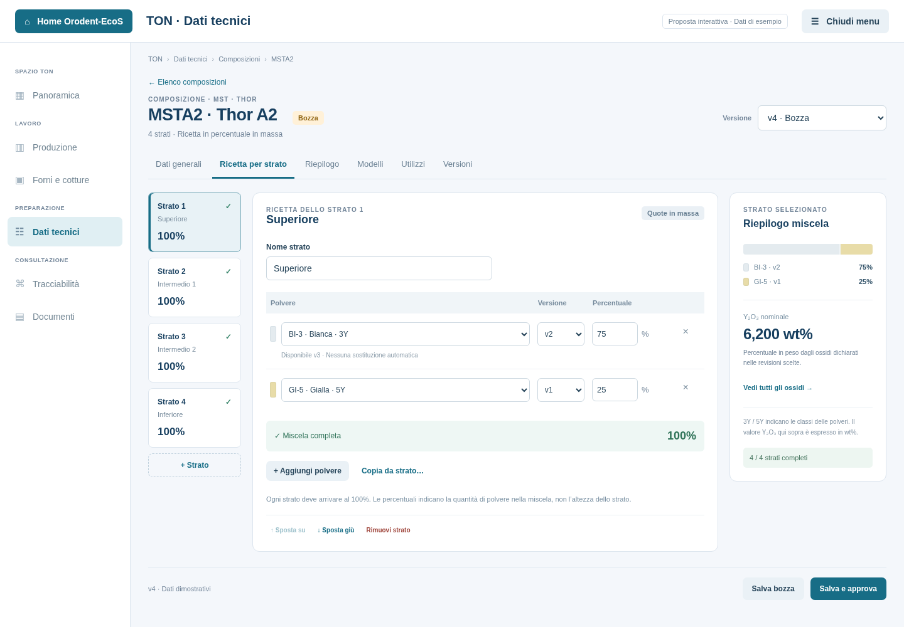
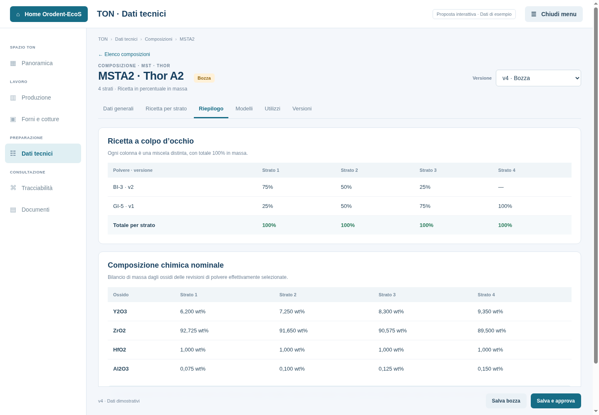

# Proposta: Composizioni

Stato: **catalogo implementato in EcoS sullo schema V6**. Consultare la
[guida della versione effettiva](ton-composizioni.md) per comandi e regole correnti.
Le sezioni seguenti conservano il disegno concordato. L'[anteprima HTML originale](mockups/ton-composizioni.html)
resta un riferimento navigabile con dati illustrativi, senza accesso al DB.
I dati del prototipo si azzerano ricaricando la pagina.

Altre schermate: [elenco](mockups/ton-composizioni-elenco.png),
[modelli](mockups/ton-composizioni-modelli.png),
[versioni](mockups/ton-composizioni-versioni.png) e
[finestra compatta](mockups/ton-composizioni-compatta.png).

## Organizzazione delle schermate

Accesso: **TON → Dati tecnici → Composizioni**.

- **Elenco**: una riga per prodotto, linea/colore, numero strati, ultima versione
  approvata ed eventuale bozza. Ricerca per prodotto, linea e colore; nella versione
  applicativa paginazione e filtri come negli altri cataloghi.
- **Dati generali**: selezione del prodotto nella prima versione, linea e colore
  ereditati in sola lettura, note della revisione. Nessun codice composizione da
  inventare: identificazione tramite prodotto e numero di versione assegnato dal servizio.
- **Ricetta per strato**: navigazione tra gli strati a sinistra, ingredienti al centro,
  riepilogo della miscela a destra. Nome facoltativo dello strato, polvere, revisione
  precisa e quota percentuale in massa. Ogni strato arriva autonomamente a 100%.
- **Riepilogo**: matrice polveri/strati e bilancio chimico nominale per ossido,
  con provenienza dai riferimenti delle polveri. Nessuna somma globale delle
  colonne: i 100% di uno strato non sono i 100% dell'altezza del modello.
- **Modelli**: versioni approvate confrontate per numero e numerazione degli strati.
  La corrispondenza strutturale non certifica la compatibilità del formato.
- **Utilizzi**: specifiche degli articoli collegate alla versione selezionata.
- **Versioni**: storico e accesso ai contenuti approvati o ritirati in sola lettura.

Nell'editor si possono aggiungere/rimuovere ingredienti, aggiungere o spostare
strati e copiare la ricetta da un altro strato con conferma. Le modifiche di uno
strato non riscrivono gli altri. Le eliminazioni non redistribuiscono le quote.

## Differenze rispetto a TON V2

In V2 la creazione può introdurre prodotto e linea, richiede un modello e attiva
la nuova composizione sul prodotto. Nell'architettura EcoS:

1. Linee e prodotti vengono dai cataloghi già operativi. Una composizione appartiene
   a un prodotto preciso, che identifica già linea e colore.
2. La ricetta definisce ingredienti e quote in massa. Geometria e percentuali di
   altezza appartengono al modello disco, già versionato separatamente.
3. La specifica dell'articolo abbina una versione approvata di composizione a una
   versione approvata di modello. Una nuova approvazione non sostituisce i riferimenti
   delle specifiche precedenti e non si attiva automaticamente su tutta una linea.
4. Le polveri sono riferite mediante `polvere_revisione_id`: una nuova scheda di
   polvere non aggiorna retroattivamente una composizione approvata.

Un futuro comando **Prepara gli strati da modello** può inizializzare una bozza
vuota per comodità, senza introdurre un collegamento esclusivo o memorizzare le
percentuali di altezza nella ricetta. Non è necessario per approvare la ricetta.

## Percentuali, ossidi e proprietà

Quote in massa con virgola o punto e quattro decimali, senza arrotondare i dati
salvati. Ogni strato contiene almeno un ingrediente, quote positive e totale
esatto `100,0000`. Una stessa polvere non compare due volte nello stesso strato,
nemmeno con revisioni differenti. Le bozze possono avere totali ancora incompleti.

Per un ossido, il valore nominale della miscela è la somma dei contributi
`quota polvere / 100 × wt% ossido`. Esempio illustrativo:

`75% × 5,150 wt% Y₂O₃ + 25% × 9,350 wt% Y₂O₃ = 6,200 wt% Y₂O₃`.

Il bilancio viene mostrato quando lo strato è completo e l'ossido è dichiarato
per tutti gli ingredienti. Un dato mancante resta **Dati parziali**, con copertura
dei dati in massa; non viene assunto pari a zero o rinormalizzata la sola parte
nota. Non si completano gli ossidi mancanti fino a 100%. Non si produce un valore
globale del disco senza conoscere la distribuzione effettiva delle masse degli strati.

La classe 3Y/4Y/5Y/6Y non si confonde con wt% Y₂O₃ e non si ricava facendo la media
delle etichette. Nel prototipo tutte le percentuali chimiche sono dimostrative.

V2 mostra medie ponderate di resistenza e traslucenza, ignorando i valori mancanti
nel denominatore. Non le proporrei come proprietà fisiche della miscela: dipendono
anche da processo, microstruttura e misurazione. Eventuali stime future avranno
un modello validato, unità, copertura e chiara distinzione dai dati sperimentali.

## Versionamento e integrazione

- **Salva bozza** aggiorna la versione modificabile; una sola bozza per prodotto.
- **Salva e approva** verifica prodotto e linea attivi, strati consecutivi,
  ingredienti distinti, polveri attive con revisioni approvate e totali al 100%.
  Una scheda chimica parziale della polvere non viene inventata per completare i dati.
- Una versione approvata conserva ricetta, riferimenti e note in sola lettura.
  **Crea nuova versione** copia esattamente i riferimenti; l'eventuale adozione di
  nuove revisioni di polvere è una scelta esplicita nella bozza.
- **Ritira** conserva i riferimenti esistenti e rimuove la versione dalle nuove
  selezioni. **Elimina bozza** richiederà assenza di utilizzi reali nel DB.
- Approvazioni, copia e cancellazione vengono eseguite in transazione sotto blocco
  del prodotto, con controllo concorrente. Nessuna ripetizione cieca dei salvataggi.

Le tabelle di base sono già presenti: `TON.COMPOSIZIONI`,
`TON.COMPOSIZIONE_STRATI`, `TON.COMPOSIZIONE_INGREDIENTI`.
L'abbinamento con il modello resta in `TON.CONFIGURAZIONI_ARTICOLO`.
Il bilancio nominale è derivato dai dati versionati, senza nuove colonne di
medie o proprietà non misurate. La struttura proposta non richiede nuovi campi.

L'implementazione userà provider/executor di EcoS, ricerca delle polveri e dei
prodotti in pagine limitate, caricamento dello strato selezionato e protezione
delle modifiche non salvate, coerentemente con gli altri cataloghi TON.

## Riferimenti esaminati

TON V2, commit `b836c23`: `CreateCompositionView`, `CreateCompositionService`,
`CompositionArchiveService`, `LayerMetricsService`, `CompositionLayerPresenter`,
`CompositionRepositoryImpl` e schema SQL. Confronto con lo schema V6 EcoS,
le revisioni delle polveri e il servizio attuale delle specifiche degli articoli.
