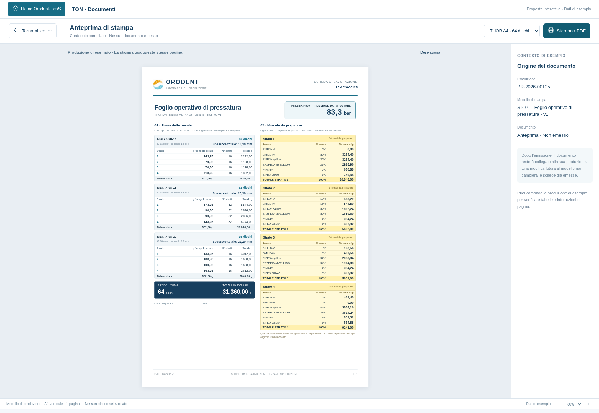

# Foglio operativo del laboratorio: requisiti dell'editor

Stato: **proposta grafica**, separata dall'applicazione e dal DB. Aprire
[il prototipo HTML](mockups/ton-documenti-laboratorio.html) nel browser.
Il modello visuale è compilato con dati dimostrativi; non è un ordine di lavoro.

[Editor con proprietà](mockups/ton-documenti-laboratorio-editor.png) ·
[PDF di esempio](mockups/ton-documenti-laboratorio.pdf).

## Informazioni necessarie per lavorare

La scheda generica precedente non era sufficiente. Il foglio operativo deve
includere questi dati, esplicitamente distinti e con unità:

| Blocco | Dato necessario |
| --- | --- |
| Identificazione | Produzione, articolo/formato, linea/colore e versioni tecniche utilizzate |
| Pressatura | Macchina utilizzata e pressione da impostare, in **bar**: nell'esempio P300, 83,3 bar |
| Dimensioni | Spessore totale del disco da pressare in **mm**, distinto dall'altezza nominale commerciale |
| Pesata per formato | Grammi per **un singolo strato** |
| Pesata per formato | Numero di strati di quel tipo da pesare |
| Pesata per formato | Grammi complessivi per quel tipo di strato nel formato |
| Totale produzione | Numero complessivo degli articoli/dischi |
| Preparazione delle miscele | Un riquadro per ogni gruppo di strati che usa la stessa ricetta, con polveri, percentuali in massa e grammi per polvere |
| Totale miscela | Massa complessiva di ciascuna miscela da preparare e numero degli strati cui è destinata |

**g/mm** e **ppm** sono dati utili alla progettazione ma facoltativi nella stampa
per gli operatori. Il prototipo li mostra solo attivando la relativa opzione.
La classe o il valore ppm non deve diventare l'identità del gruppo: il numero di
strato, il prodotto e la revisione di ricetta restano i riferimenti effettivi.

## Esempio rappresentato

Tre formati da 16, 32 e 16 dischi danno **64 dischi complessivi**. Con quattro
strati per disco, ogni riquadro giallo prepara la miscela per **64 strati dello
stesso numero**; le pesate singole sono 256 nell'intera produzione.

La massa unitaria dipende dal formato. Perciò il fabbisogno dello strato 1 è la
somma delle masse dello strato 1 dei tre formati, ciascuna moltiplicata per il
numero di dischi di quel formato. Nel campione illustrativo i totali da dosare
sono 10.848 g, 5.632 g, 5.632 g e 9.248 g: **31.360 g** complessivi.

La somma dei quattro pesi unitari è il peso di un disco, non il totale della
produzione. Il numero degli articoli non va ottenuto sommando il conteggio di
tutte le righe degli strati: quattro righe da 16 pesate corrispondono a 16 dischi,
non a 64 dischi.

Il prototipo usa percentuali dimostrative che sommano al 100%, non trascritte
come ricette di lavoro dal foglio originale. Anche spessori e pressione servono
a verificare la presenza e la leggibilità dei campi, non a validare il processo.

## Calcoli e dati da definire prima dell'implementazione

- La miscela si raggruppa soltanto quando coincidono prodotto, versione della
  composizione e strato. Lo stesso numero di strato in ricette diverse non basta.
- I totali si ricavano dai valori di calcolo completi; non dai pesi unitari già
  arrotondati per la visualizzazione. Precisione delle bilance, arrotondamenti
  e gestione dei residui devono essere regole esplicite e versionate.
- Nel foglio originale il fabbisogno del primo strato è 10.848 g, mentre il suo
  riquadro miscela riporta 10.902,2 g. È stato chiesto se questa differenza deriva
  da una maggiorazione di preparazione. La regola non è stata dedotta: nell'esempio
  nuovo non è applicata alcuna maggiorazione. Se confermata, dose necessaria,
  maggiorazione e quantità da preparare vanno conservate separatamente.
- La pressione macchina in bar va determinata dalla regola della pressa e dai
  suoi parametri, non da una semplice conversione della pressione sul materiale
  in kg/cm². Prima di calcolarla occorre confermare come si ottiene il valore
  della P300. Nel prototipo è un dato di esempio già fornito.
- Spessore nominale e spessore complessivo da pressare sono campi distinti.
  Il secondo deve usare il modello e i sovramateriali effettivamente scelti.
- Eventuali premiscele da preparare a loro volta e controlli «OK» devono diventare
  blocchi e stati espliciti, senza perdere le relazioni fra miscela e componenti.
  Il loro flusso operativo va definito con l'utente prima di renderlo eseguibile.

## Comportamento richiesto all'editor

I blocchi operativi sono inseribili senza scrivere formule. L'utente può scegliere
impaginazione e stile; TON fornisce pesate, raggruppamenti, composizioni e parametri.
Un modello dichiarato come scheda operativa di laboratorio deve essere controllato
prima dell'approvazione/emissione: dati necessari mancanti non possono sparire
senza segnalazione. Nel prototipo è simulato il controllo della presenza del
foglio operativo e le informazioni necessarie sono indicate nelle proprietà.
La validazione completa dei campi e dei dati sarà parte dell'implementazione.

La stampa può affiancare pesate e preparazione delle miscele come nell'esempio;
se il contenuto non entra in modo leggibile, deve continuare su altre pagine,
con identificazione della produzione e intestazioni ripetute. Non deve essere
tagliato o ridotto automaticamente fino a diventare illeggibile.

Il documento emesso conserverà il PDF esatto, la versione del modello e il
collegamento alla produzione. Nuove ricette, pressioni o layout non riscriveranno
i documenti già emessi. Restano validi i requisiti di conservazione descritti
nella [proposta dell'editor](ton-documenti-proposta.md).
