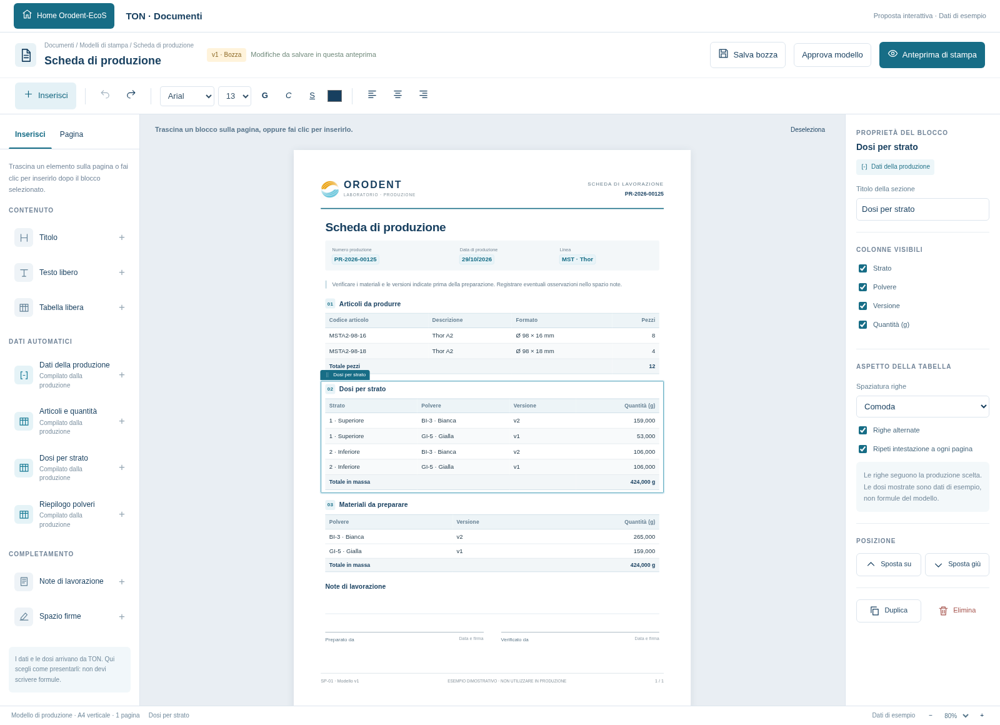

# Proposta: editor visuale dei documenti TON

Stato: **prototipo grafico interattivo**, non ancora integrato nell'applicazione.
L'[editor Tiptap offline](ton-editor-visuale.md), con pannelli e blocchi dimostrativi,
è incluso nelle risorse di TON. Il collegamento al menu dell'applicazione, ai dati
produttivi reali e alle emissioni resta da integrare.
Aprire [ton-documenti.html](mockups/ton-documenti.html) in un browser. Il file è
autonomo e non richiede Internet. Tutti i dati produttivi e le dosi sono esempi:
non vengono letti dal DB né calcolati dal prototipo.

**Aggiornamento sui requisiti del laboratorio:** la prima scheda era generica.
La [proposta operativa](mockups/ton-documenti-laboratorio.html) rappresenta ora
le pesate per formato e le quattro miscele distinte descritte dall'utente.
Vedere [requisiti e dati del foglio operativo](ton-documenti-laboratorio.md),
[immagine](mockups/ton-documenti-laboratorio-anteprima.png) e
[PDF dimostrativo](mockups/ton-documenti-laboratorio.pdf).

Altre viste: [anteprima compilata](mockups/ton-documenti-anteprima.png),
[produzione su più pagine](mockups/ton-documenti-multipagina.png) e
[finestra compatta](mockups/ton-documenti-compatta.png).
PDF di esempio: [scheda breve](mockups/ton-documenti-esempio.pdf) e
[scheda su due pagine](mockups/ton-documenti-esempio-lungo.pdf).

## Esperienza concordata

Il modello si costruisce come un documento: testo modificabile sulla pagina,
formattazione e blocchi trascinabili. Non occorre scrivere FreeMarker, HTML,
SQL o formule. I calcoli produttivi restano responsabilità dei servizi TON;
il documento presenta risultati già determinati e con unità esplicite.

- **Sinistra — Inserisci:** titolo, testo, tabella libera, dati della produzione,
  articoli e quantità, dosi per strato, riepilogo delle polveri, note e firme.
  Un clic inserisce il blocco dopo quello selezionato; il trascinamento permette
  di scegliere la posizione. La maniglia del blocco selezionato lo riordina.
- **Centro — Documento:** pagina A4 con margini, intestazione e piè di pagina.
  Le evidenziazioni azzurre identificano i campi automatici e spariscono in stampa.
  I dati delle tabelle dinamiche si modificano nel flusso produttivo, non nel layout.
- **Destra — Proprietà:** titolo della sezione, colonne visibili, righe alternate,
  spaziatura, ripetizione dell'intestazione, spostamento, duplicazione ed eliminazione.
  Nei testi si possono inserire campi con nomi comprensibili, ad esempio
  «Numero produzione» o «Operatore».
- **Barra superiore:** formattazione, annulla/ripeti, salvataggio della bozza,
  approvazione del modello e anteprima di stampa.

I blocchi seguono il normale flusso delle pagine. Il riordino non usa coordinate
assolute che farebbero sovrapporre una tabella lunga a quella successiva.
Sotto 1250 px le proprietà si aprono da un pulsante; sotto 850 px anche il pannello
Inserisci diventa richiudibile. Lo zoom è indipendente dalle misure di stampa.

## Cosa si può provare

1. Trascinare una tabella nel documento e riordinare i blocchi dalla maniglia.
2. Scrivere nei testi, applicare grassetto/corsivo/sottolineato, cambiare carattere,
   dimensione, colore e allineamento del blocco. La formattazione fine del testo
   è dimostrativa; non è ancora un motore di impaginazione completo.
3. Cambiare righe e colonne di una tabella libera; nascondere una colonna della tabella dosi o cambiare la spaziatura delle righe.
4. Duplicare, eliminare e annullare una modifica.
5. Cambiare orientamento e margini nella scheda **Pagina**.
6. Aprire **Anteprima di stampa** e scegliere la produzione breve o lunga:
   rispettivamente una o due pagine con il modello iniziale.
7. Usare **Stampa / PDF** per la stampa del browser, senza pannelli dell'editor.
8. Salvare la bozza nel browser e riprenderla da **Pagina → Riprendi bozza salvata**.

Il salvataggio è soltanto locale al browser; ricaricando si torna inizialmente
all'esempio, senza cancellare la bozza salvata. Approvazione e nuova versione
simulano sola lettura e ritorno in modifica. Il prototipo non offre ancora
l'archivio completo delle versioni approvate, né emette documenti reali.

## Requisiti per il risultato stampato

- Stessa impaginazione nell'anteprima finale e nel PDF archiviato.
- Formato, margini, caratteri e risorse del documento conservati esplicitamente.
- Testi leggibili, numeri allineati, unità e decimali coerenti con il dato.
- Tabelle multipagina con intestazioni ripetute, senza perdita o duplicazione
  delle righe; titoli e totali mantenuti con il contenuto cui si riferiscono.
- Numerazione delle pagine e identificazione della produzione su ogni foglio.
- Spazi destinati a note e firme, senza dipendere dalle righe prodotte.

La paginazione JavaScript e la stampa browser qui servono a valutare l'idea.
L'implementazione dovrà scegliere e verificare il motore definitivo di editor
e PDF su Windows, font inclusi. La vista finale dovrà mostrare il PDF effettivo;
una semplice anteprima HTML non è sufficiente a garantirne l'uguaglianza.
Non si devono perdere righe o troncare contenuti troppo grandi per una pagina:
servono suddivisione controllata o un errore esplicito prima dell'emissione.

## Produzione, modello e documento emesso

Esempio del collegamento previsto:

| Identità | Contenuto |
| --- | --- |
| Modello SP-01 v3 | Layout approvato della scheda di produzione |
| Produzione PR-00125 | Articoli, quantità, specifiche e dosi effettivamente confermati |
| Documento DOC-00418 | Emissione conservata di quella produzione con SP-01 v3 |

Il modello approvato è immutabile. La sua nuova versione non aggiorna le schede
già emesse. La ristampa apre il documento archiviato, senza rigenerarlo dai dati
correnti. Un'ulteriore emissione riceve una nuova identità e conserva le precedenti.

Il DB contiene già `TON.MODELLI_DOCUMENTO` e `TON.DOCUMENTI`, con FK verso
versione del modello e produzione/cottura. Il contenuto emesso attualmente previsto
è un CLOB: per conservare il PDF esatto servirà una nuova migrazione per il binario
o un archivio condiviso gestito. Non si modifica la migrazione V4 pubblicata.
I PDF non vanno conservati soltanto come percorsi temporanei sul PC dell'HOST.

Prima della generazione bisogna registrare la produzione e la versione di modello
scelta, anche se l'emissione fallisce. Tale scelta dovrà essere persistita sulla
produzione o sulla richiesta di emissione: il solo riferimento nel documento
finale non basta a gestire una generazione interrotta. I dati di stampa devono
derivare dalla produzione e dalle specifiche storiche confermate, includendo le
dosi congelate; non dalle schede tecniche correnti.

Generazione PDF, conservazione ed invio alla stampante sono passaggi distinti.
Un errore alla stampante non crea un'altra produzione e la ristampa non emette
un nuovo documento. Dopo un errore di connessione non si ripetono scritture alla
cieca; si verifica prima l'esito della richiesta di emissione identificata.

## Ordine proposto per l'implementazione

1. Editor visuale e modello di documento versionato, usando dati di esempio.
2. Motore di rendering e PDF, verificando schede corte, lunghe e casi limite.
3. Collegamento ai dati storici della produzione e archivio delle emissioni.
4. Riapertura e ristampa dalla produzione; successiva estensione alle cotture.

Il primo passaggio non richiede di completare prima la schermata Produzione.
Il contratto dei dati può essere definito ora e alimentato inizialmente con esempi.
