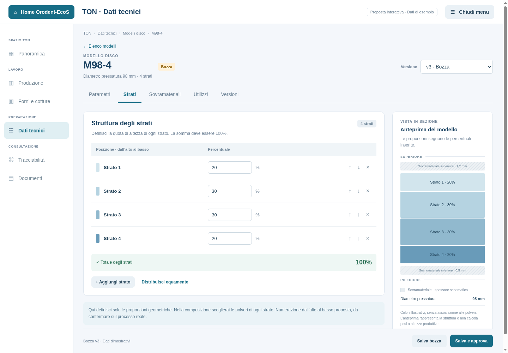

# Proposta grafica: Modelli disco

Stato: **proposta navigabile**, senza collegamento al DB o modifiche all'applicazione.
Aprire [l'anteprima HTML](mockups/ton-modelli-disco.html) in un browser.
Funziona offline; i dati sono dimostrativi e si azzerano ricaricando la pagina.

Altre viste: [elenco](mockups/ton-modelli-elenco.png),
[parametri](mockups/ton-modelli-parametri.png),
[sovramateriali](mockups/ton-modelli-sovramateriali.png),
[versioni](mockups/ton-modelli-versioni.png) e
[finestra compatta](mockups/ton-modelli-compatti.png).

## Schermate

- **Elenco**: una riga per codice modello, diametro di pressatura, strati,
  ultima versione approvata ed eventuale bozza. Ricerca e filtro per stato.
- **Parametri**: codice, diametro di pressatura, pressione in kg/cm² come in V2,
  coefficiente g/mm, note. Il codice identifica il modello nelle sue versioni.
- **Strati**: tabella dall'alto al basso, percentuali, totale, aggiunta,
  rimozione e riordino. Distribuzione uniforme solo su richiesta esplicita.
  Anteprima della sezione affiancata, con colori puramente illustrativi.
- **Sovramateriali**: default superiore/inferiore e fasce di altezza facoltative,
  con intervalli `[da, fino a)` senza sovrapposizioni.
- **Utilizzi**: specifiche degli articoli che utilizzano la versione precisa.
- **Versioni**: bozza, approvate e ritirate, con apertura in sola lettura.

La selezione della versione resta in alto. Le azioni di salvataggio e
approvazione sono nella barra inferiore. Su finestre strette l'anteprima
passa sotto l'editor e il menu laterale lascia spazio al contenuto.

## Collegamento a EcoS

Modello e composizione sono riutilizzabili. Le specifiche di produzione
dell'articolo abbinano le loro versioni precise. Un nuovo modello approvato
non sostituisce automaticamente i riferimenti già utilizzati.

Le tabelle esistenti sono sufficienti per i dati tecnici proposti:

| Tabella | Contenuto |
| --- | --- |
| TON.MODELLI_DISCO | Codice/versione, stato, parametri e note |
| TON.MODELLO_STRATI | Numero dello strato e percentuale di altezza |
| TON.MODELLO_SOVRAMATERIALI | Eccezioni per fascia di altezza, per versione |

L'implementazione dovrà garantire transazioni, concorrenza, una bozza per codice,
immutabilità dei contenuti approvati, controllo dei riferimenti prima di eliminare
una bozza e letture paginate asincrone con provider/executor di EcoS.
Non basta usare il numero di versione come protezione dalle modifiche concorrenti.

## Convenzioni da confermare prima dei calcoli

- Numerazione degli strati dall'alto al basso: proposta esplicita nell'anteprima.
- Quote di altezza nominale e distribuzione dei sovramateriali agli strati estremi,
  incluso il caso monostrato: definire la regola prima di mostrare pesi/quote in mm.
- Diametro nominale dell'articolo e diametro di pressatura: non imporre uguaglianza
  senza una regola di processo confermata.

Il prototipo mostra proporzioni geometriche e sovramateriali schematici,
senza simulare risultati di produzione.

## Riferimenti esaminati

TON V2, commit `b836c23`:

- features/laboratory/diskmodel/view/CreateDiskModelView.java
- features/laboratory/diskmodel/view/partial/DiskModelPreviewView.java
- features/laboratory/diskmodel/service/CreateDiskModelService.java
- features/laboratory/diskmodel/service/DiskModelArchiveService.java
- config/DB_schema.sql

EcoS: migrazione V4, guida dello schema TON e gestione delle specifiche degli articoli.

In V2 il cambio del numero di strati ricrea tutte le percentuali; l'anteprima
proposta preserva i valori all'aggiunta e richiede un'azione per redistribuirli.
V2 valida le singole fasce ma non le sovrapposizioni. La nuova versione dovrà
controllare gli intervalli nel servizio, oltre che nella UI.
