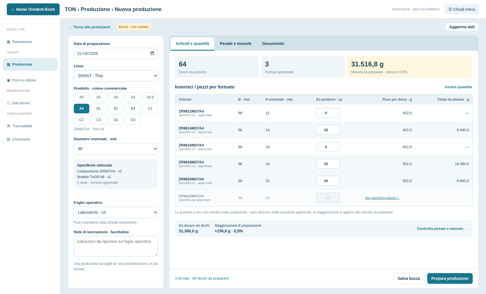

# Proposta: preparazione della produzione TON

Stato: **implementata in EcoS**; la [guida alla produzione](ton-produzione.md)
descrive il comportamento reale. Il [mockup interattivo](mockups/ton-produzione.html)
resta un riferimento grafico con dati dimostrativi, senza accesso al DB.
Il documento nell'applicazione usa il modello approvato dall'utente: il layout
dimostrativo del mockup non è imposto ai fogli operativi. La pressione visualizzata
è quella reale del modello in kg/cm²; la conversione macchina richiederà la futura
configurazione dei macchinari.

## Flusso concordato

L'utente descrive i dischi che **vuole produrre**. Il programma usa composizione,
modello e quantità per stabilire le dosi da pesare e pressare.
Non è una registrazione a posteriori di dischi già realizzati.
Una produzione comprende **un solo prodotto/colore, in più formati**.

1. Scegliere linea e prodotto/colore.
2. Scegliere il diametro e inserire i pezzi dei formati richiesti.
3. Controllare dosi per disco/strato e miscele complessive da preparare.
4. Scegliere facoltativamente il modello di foglio operativo e aggiungere note.
5. Salvare la bozza oppure **Prepara produzione** per fissare il piano di lavoro
   e ottenere il foglio operativo prima di pesare e pressare.

La bozza serve a riprendere un inserimento incompleto. Preparare il piano non
attesta l'esecuzione fisica, non certifica pezzi buoni e non movimenta scorte.

## Proposta grafica

La palette riprende inserimento multiplo: sfondo azzurro, pannelli bianchi,
intestazioni leggibili e azione principale petrolio. La pagina ha una struttura
operativa propria; non usa il contenitore delle schede di Dati tecnici.

**Sinistra:** data di preparazione, linea, colori commerciali, diametro, riferimenti
alle specifiche approvate, scelta del documento e note.

**Destra:** tre schede e una barra delle azioni sempre raggiungibile.

| Scheda | Contenuto |
| --- | --- |
| Articoli e quantità | Articoli disponibili, formato, pezzi richiesti, peso unitario e totale; riepilogo immediato dei dischi e delle masse |
| Pesate e miscele | Dose del singolo strato per ciascun formato e riquadri delle miscele da preparare |
| Documento | Anteprima del foglio operativo con le quantità correnti, versioni, pesate e miscele |

Le colonne si ridimensionano senza mettere tutta la pagina in uno scroll pane
nella vista a due colonne. Scorrono gli elenchi e i contenuti che eccedono lo
spazio. Il mockup mostra anche il comportamento compatto.

[Pesate e miscele](mockups/ton-produzione-pesate.png) ·
[Documento](mockups/ton-produzione-documento.png) ·
[Elenco delle produzioni](mockups/ton-produzione-elenco.png) ·
[Finestra compatta](mockups/ton-produzione-compatta.png).

## Funzioni del mockup

- Le quantità positive aggiornano conteggi, masse e anteprima; lo zero esclude il formato.
- I formati senza specifica approvata restano visibili con il motivo della mancata disponibilità.
- Cambiare linea, colore o diametro con quantità già inserite richiede conferma;
  annullando si conservano selezione e quantità.
- **Salva bozza** e **Prepara produzione** sono simulati; il secondo mostra un
  riepilogo prima della conferma. Una produzione preparata si riapre in sola lettura.
- **Duplica** riparte da quantità e impostazioni della produzione aperta.
- Il ritorno all'elenco conserva le bozze simulate; ricerca, filtro di stato,
  doppio clic e Invio permettono di riprenderle.
- La stampa del browser riguarda solo il foglio dimostrativo. L'anteprima è
  distinta dal futuro documento emesso e conservato dall'applicazione.

L'esempio iniziale contiene 64 dischi: 16 da 14 mm, 32 da 18 mm e 16 da 20 mm.
Il modello dimostrativo usa quattro strati 30/20/20/30%, 25 g/mm,
sovramateriali superiore 1,5 mm e inferiore 0,6 mm: **31.360,0 g da dosare** e
**31.516,8 g da preparare**. Le ricette sono dimostrative, non indicazioni di lavoro.

## Regole da conservare nell'implementazione

- Selezionare la specifica approvata dell'articolo, che identifica esattamente
  le versioni di composizione e modello. Non ricercare la ricetta «attiva» durante
  l'emissione, perché potrebbe essere cambiata nel frattempo.
- Per il primo flusso proporrei un unico abbinamento composizione/modello nel batch,
  come in V2. Eventuali formati con specifiche diverse devono essere segnalati,
  non aggregati implicitamente. Questo dettaglio resta da confermare con l'utente.
- Tenere distinti **altezza nominale**, spessore effettivo da pressare e diametro
  di pressatura. Applicare il modello e le fasce di sovramateriale pertinenti.
- Dose per disco, dose totale da distribuire e miscela da preparare sono quantità
  diverse. Il fattore concordato **1,005** si applica una sola volta alle miscele.
- Precisione operativa concordata: **0,1 g**. Aggregare i valori analitici prima
  dell'arrotondamento. La ripartizione dei residui fra polveri deve mantenere la
  somma uguale al totale di ciascuna miscela; la regola proposta va validata con
  esempi reali prima dell'uso produttivo.
- Raggruppare una miscela solo quando coincidono prodotto, versione di
  composizione e strato. Non basta che due righe riportino «Strato 1».
- La pressione P300 a 83,3 bar nel mockup è un esempio. La regola macchina va
  confermata: non si ottiene convertendo semplicemente kg/cm² in bar.
- Fissare specifiche, parametri e dosi alla preparazione; conservare regola di
  calcolo e precisione. Le nuove versioni tecniche non riscrivono il lavoro preparato.
- Un errore di generazione o stampa non deve creare una seconda produzione.
  Il foglio potrà essere generato o ristampato dalla registrazione già salvata.

Le formule operative dovranno usare decimali esatti nei servizi Java. Il
JavaScript del mockup illustra interazioni e disposizione, non è il servizio
produttivo da portare nell'applicazione.

## Due decisioni prima di programmare

1. **Preparazione definitiva:** propongo che «Prepara produzione» fissi specifiche
   e dosi, rendendo il piano consultabile e ristampabile; le variazioni successive
   devono essere esplicite. Va concordato come correggere le quantità dopo questa
   operazione senza perdere la storia.
2. **Documenti:** propongo modello facoltativo, anteprima durante l'inserimento,
   emissione conservata dopo il salvataggio del piano. Non condizionare il
   salvataggio alla riuscita della stampante.

Il database attuale chiama il campo `quantita_prodotta` e distingue BOZZA,
CONFERMATA e ANNULLATA. Questi nomi non devono trasformare le quantità richieste
in pezzi realmente eseguiti: prima dell'implementazione va allineato il significato
della registrazione alla preparazione richiesta dall'utente, separandola dagli
esiti fisici e dalle quantità disponibili per i forni. Questa proposta non
modifica le migrazioni né anticipa la realizzazione di Forni e cotture.

## Riferimento TON V2

Verificato il repository `UniSgamb98/TON-V2`, commit
`b836c23e6b90bcce2fcb76094a12af3b6aee2a0f`:

- `BatchProductionView`: linea, prodotto, quantità, modello documento e note;
  pagina lunga con riepilogo laterale.
- `BatchProductionFormState`: il cambio linea o prodotto azzera le quantità.
- `BatchProductionService.buildPlan`: un unico abbinamento composizione/modello,
  controllo della linea e quantità positive.
- `BatchProductionController`: prima salva il batch, poi genera il documento;
  il fallimento documentale non annulla il salvataggio.

Il passaggio a EcoS deve conservare il flusso utile e migliorare visibilità delle
pesate, protezione delle quantità inserite e uso delle specifiche versionate.
Vedere [foglio operativo del laboratorio](ton-documenti-laboratorio.md),
[specifiche degli articoli](ton-cataloghi.md) e
[schema attuale e flussi da costruire](ton-schema-proposta.md).
