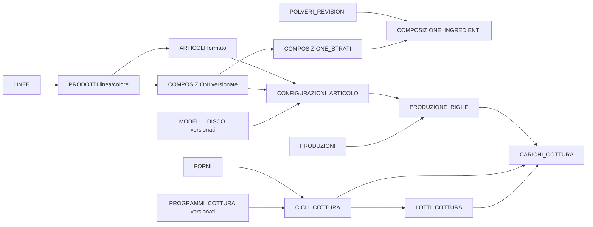

# Proposta di schema TON per Orodent-EcoS

Stato: **struttura SQL V4, colore polveri V5 e cataloghi con storico V6**. `TON.PRODOTTI` esiste
dalla V3; `V4__ton_domain.sql` aggiunge le altre 24 tabelle, senza importare dati
da TON-V2. I sei cataloghi tecnici sono operativi, comprese versioni, ossidi,
composizioni per strato e modelli disco. Vedere anche la [guida delle composizioni](ton-composizioni.md).
Questo documento descrive
anche regole applicative previste per i flussi ancora da costruire. Il cubaggio
rimane fuori da questo passaggio. Vedere [uso delle polveri](ton-polveri.md).

L'obiettivo è mantenere il percorso di TON-V2 — cataloghi, composizioni, modelli,
produzioni, forni, lotti e documenti — rendendo espliciti i dati tecnici storici e
le regole di concorrenza. Tutte le tabelle risiedono nel database `OrodentEcoS`,
nello schema `TON`. I codici articolo coincidono con quelli delle vendite di
Statistiche; il collegamento delle schermate sarà implementato successivamente.
La [guida dei cataloghi](ton-cataloghi.md) descrive le regole effettivamente disponibili.

## Come leggere la proposta

- **PK**: identificatore della riga; **FK**: riferimento a un'altra tabella;
  **UQ**: combinazione che non può essere duplicata; `?`: campo facoltativo.
- Gli ID sono `BIGINT`, normalmente generati dal DB. Le tabelle ponte con PK
  composta non hanno un ulteriore ID.
- Quantità di pezzi: `INTEGER`; misure e percentuali: `DECIMAL`, gestiti con
  `BigDecimal` in Java. Niente `DOUBLE` per percentuali nominali.
- `codice` è un codice leggibile, normalizzato e univoco nell'ambito indicato.
  Gli ID restano stabili quando si correggono le descrizioni.
- I cataloghi modificabili hanno `attivo BOOLEAN`, `versione_modifica INTEGER`,
  `creato_il TIMESTAMP`, `aggiornato_il TIMESTAMP`, oltre ai campi sotto elencati.
  `versione_modifica` serve a impedire sovrascritture tra operatori.
- Le schede tecniche versionate hanno `numero_versione INTEGER`, stato
  `BOZZA/APPROVATA/RITIRATA`, `versione_modifica`, `creato_il`, `aggiornato_il`,
  `approvato_il?`. Una versione approvata è immutabile nei contenuti tecnici,
  compresi i figli; può essere ritirata da nuovi utilizzi. Una correzione crea
  una nuova versione. Il numero tecnico e la revisione per la concorrenza sono
  due concetti distinti.
- Le registrazioni operative hanno `versione_modifica`, `creato_il`,
  `aggiornato_il`. Gli eventi storici immutabili hanno solo `creato_il`.
- I dati già usati non vengono eliminati fisicamente. Nessun `ON DELETE CASCADE`
  deve cancellare la storia produttiva. Le sole bozze mai utilizzate possono
  essere rimosse, in una transazione esplicita.
- Un futuro operatore EcoS potrà aggiungere riferimenti di autore e approvatore;
  questa proposta non introduce un login separato per TON.

## Mappa dei collegamenti

La configurazione è l'abbinamento approvato di **articolo + composizione + modello**.
La produzione registra quale configurazione ha realmente usato. Il caricamento
collega una quantità di una specifica riga produttiva a uno specifico ciclo.

## A. Cataloghi: 4 tabelle

### 1. `TON.PRODOTTI` — già presente

| Campo | Tipo | Significato |
|---|---|---|
| `prodotto_id` | BIGINT PK | Identità del prodotto tecnico |
| `codice` | VARCHAR(50) UQ | Per esempio `ZR A2` |
| `descrizione` | VARCHAR(200) ? | Descrizione libera |
| `linea_id` | BIGINT FK → LINEE ? | Unica linea canonica, da completare per i legacy ambigui |
| `colore_commerciale` | VARCHAR(30) ? | Colore del prodotto; obbligatorio nei nuovi salvataggi |
| `note` | VARCHAR(1000) ? | Note del prodotto |
| `attivo`, `versione_modifica`, `creato_il`, `aggiornato_il` | Come sopra | Campi già presenti in V3 |

Un prodotto identifica una linea e un colore commerciale, non una specifica
ricetta né una singola altezza. UQ (linea_id, colore_commerciale). Gli ID V3
restano invariati. Codici precedenti e correzioni sono conservati nello storico.

### 2. `TON.LINEE`

| Campo | Tipo | Significato |
|---|---|---|
| `linea_id` | BIGINT PK | Identità della linea |
| `codice` | VARCHAR(50) UQ | Codice stabile |
| `nome` | VARCHAR(100) | Nome leggibile |
| `tecnologia` | VARCHAR(200) ? | Descrizione della tecnologia |
| `materia_prima` | VARCHAR(30) ? | Eventuale materia prima |
| `note` | VARCHAR(1000) ? | Note della linea |

Più i campi comuni dei cataloghi. Una linea raggruppa i prodotti pensati con
la stessa tecnologia e ha un’anagrafica unica.

### 3. `TON.LINEE_PRODOTTI`

| Campo | Tipo | Significato |
|---|---|---|
| `linea_id` | BIGINT PK, FK → LINEE | Linea |
| `prodotto_id` | BIGINT PK, FK → PRODOTTI | Prodotto appartenente alla linea |

PK composta `(linea_id, prodotto_id)`. **Tabella legacy conservata dalla V4**:
le associazioni precedenti restano consultabili per completare i prodotti
ambigui. Da V6 il catalogo corrente usa una sola PRODOTTI.linea_id.

### 4. `TON.ARTICOLI`

| Campo | Tipo | Significato |
|---|---|---|
| `articolo_id` | BIGINT PK | Identità dell'articolo tecnico |
| `codice` | VARCHAR(80) UQ | Per esempio `ZR-A2-D98-H14` |
| `prodotto_id` | BIGINT FK → PRODOTTI | Linea e colore ereditati dal prodotto |
| `diametro_mm` | DECIMAL(6,2) | Diametro nominale del formato |
| `altezza_mm` | DECIMAL(6,2) | Altezza nominale del formato |
| `descrizione` | VARCHAR(200) ? | Descrizione dell'articolo |
| `configurazione_predefinita_id` | BIGINT FK → CONFIGURAZIONI_ARTICOLO ? | Scelta iniziale proposta dalla UI |

Più i campi comuni dei cataloghi. UQ `(prodotto_id, diametro_mm, altezza_mm)`;
misure positive. Si assume per ora un formato circolare identificato da diametro
e altezza; nuove geometrie richiederanno un'estensione esplicita.

La configurazione predefinita deve appartenere allo stesso articolo: FK composta
`(articolo_id, configurazione_predefinita_id)` verso
`CONFIGURAZIONI_ARTICOLO(articolo_id, configurazione_id)`. Il riferimento può essere
nullo finché non esiste una configurazione approvata. L'implementazione aggiunge
questa FK dopo aver creato entrambe le tabelle.

Prodotto e dimensioni di un articolo già utilizzato sono immutabili: un formato
diverso è un altro articolo. Descrizione, stato attivo e configurazione proposta
possono cambiare senza riscrivere le produzioni passate.

## B. Polveri e caratteristiche storiche: 3 tabelle

### 5. `TON.POLVERI`

| Campo | Tipo | Significato |
|---|---|---|
| `polvere_id` | BIGINT PK | Identità stabile della polvere |
| `codice` | VARCHAR(50) UQ | Per esempio `P-BIANCA` |
| `nome` | VARCHAR(100) | Nome leggibile |
| `colore` | VARCHAR(10) | BIANCA, GIALLA, ROSA o GRIGIA; da V5 |

Più i campi comuni dei cataloghi. Questa tabella identifica il tipo di polvere,
non un lotto fisico acquistato; il colore è comune alle versioni.
L'ordinamento è bianche, gialle, rosa, grigie,
poi codice. Per le anagrafiche precedenti alla V5 `colore` può essere NULL
(da specificare); il vecchio `ordine_visualizzazione` resta conservato ma non
viene più usato per ordinare né modificato dal catalogo.

### 6. `TON.POLVERI_REVISIONI`

| Campo | Tipo | Significato |
|---|---|---|
| `polvere_revisione_id` | BIGINT PK | Scheda tecnica precisa |
| `polvere_id` | BIGINT FK → POLVERI | Polvere di appartenenza |
| `numero_versione` | INTEGER | Versione della scheda |
| `resistenza_mpa` | DECIMAL(10,3) ? | Resistenza dichiarata |
| `traslucenza` | DECIMAL(10,4) ? | Valore dichiarato, scala da concordare |
| `classe_ittria_y` | INTEGER ? | Per esempio 3, 4 o 5 per 3Y/4Y/5Y |
| `note` | VARCHAR(1000) ? | Annotazioni tecniche |

Più il ciclo di vita delle schede tecniche. UQ `(polvere_id, numero_versione)`;
versione positiva. Scala e metodo della traslucenza vanno fissati prima di
applicare vincoli numerici: non si assume che sia automaticamente una percentuale.
La classe 3Y/4Y/5Y non sostituisce la composizione chimica.

Una composizione si riferisce alla revisione precisa, non alla scheda più recente.
Cambiare le caratteristiche della polvere non cambia i vecchi calcoli.

### 7. `TON.POLVERE_OSSIDI`

| Campo | Tipo | Significato |
|---|---|---|
| `polvere_revisione_id` | BIGINT PK, FK → POLVERI_REVISIONI | Scheda tecnica |
| `ossido_codice` | VARCHAR(30) PK | Per esempio `ZRO2`, `Y2O3` |
| `percentuale_massa` | DECIMAL(7,4) | Percentuale in massa |

PK composta, percentuale > 0 e <= 100. La scheda può riportare un'analisi
parziale: non si impone la somma 100 senza un requisito esplicito. Nomi degli
ossidi normalizzati; un catalogo separato servirà solo se avrà attributi propri.

## C. Composizioni: 3 tabelle

### 8. `TON.COMPOSIZIONI`

| Campo | Tipo | Significato |
|---|---|---|
| `composizione_id` | BIGINT PK | Versione precisa della ricetta |
| `prodotto_id` | BIGINT FK → PRODOTTI | Prodotto cui si riferisce |
| `numero_versione` | INTEGER | Per esempio 3 |
| `note` | VARCHAR(1000) ? | Motivo/descrizione della versione |

Più il ciclo di vita delle schede tecniche. UQ `(prodotto_id, numero_versione)`.
Il numero degli strati si ricava dai figli: non si mantiene un secondo contatore.

### 9. `TON.COMPOSIZIONE_STRATI`

| Campo | Tipo | Significato |
|---|---|---|
| `composizione_id` | BIGINT PK, FK → COMPOSIZIONI | Ricetta |
| `numero_strato` | INTEGER PK | Posizione a partire da 1 |
| `nome` | VARCHAR(100) ? | Etichetta facoltativa |

PK composta. All'approvazione gli strati devono essere presenti e consecutivi;
la direzione, per esempio dall'inferiore al superiore, deve essere unica in tutta
l'app. Questa tabella descrive la ricetta dello strato, non il suo spessore.

### 10. `TON.COMPOSIZIONE_INGREDIENTI`

| Campo | Tipo | Significato |
|---|---|---|
| `composizione_id` | BIGINT PK | Ricetta |
| `numero_strato` | INTEGER PK | Strato |
| `polvere_revisione_id` | BIGINT PK, FK → POLVERI_REVISIONI | Polvere e caratteristiche utilizzate |
| `percentuale_massa` | DECIMAL(7,4) | Quota nella miscela dello strato |

FK composta `(composizione_id, numero_strato)` → COMPOSIZIONE_STRATI. Ogni quota
è > 0 e <= 100. Quando si approva, **ciascuno strato deve sommare esattamente
100,0000**. Una ricetta non approvata può essere incompleta. Non si mescolano
revisioni diverse della stessa polvere nel medesimo strato.

## D. Modelli disco e configurazioni: 4 tabelle

### 11. `TON.MODELLI_DISCO`

| Campo | Tipo | Significato |
|---|---|---|
| `modello_id` | BIGINT PK | Versione precisa del modello |
| `codice` | VARCHAR(100) | Per esempio `ML-98` |
| `numero_versione` | INTEGER | Versione tecnica |
| `diametro_pressatura_mm` | DECIMAL(6,2) | Diametro impiegato dalla lavorazione |
| `sovramateriale_superiore_mm` | DECIMAL(6,2) | Default superiore |
| `sovramateriale_inferiore_mm` | DECIMAL(6,2) | Default inferiore |
| `pressione_kg_cm2` | DECIMAL(10,3) | Pressione, unità esplicita come in TON-V2 |
| `grammi_per_mm` | DECIMAL(12,5) | Coefficiente del modello |
| `note` | VARCHAR(1000) ? | Annotazioni |

Più il ciclo di vita delle schede tecniche. UQ `(codice, numero_versione)`;
pressione, diametro e coefficiente positivi; sovramateriali non negativi.

### 12. `TON.MODELLO_STRATI`

| Campo | Tipo | Significato |
|---|---|---|
| `modello_id` | BIGINT PK, FK → MODELLI_DISCO | Modello |
| `numero_strato` | INTEGER PK | Posizione |
| `percentuale_altezza` | DECIMAL(7,4) | Quota di altezza dello strato |

Strati consecutivi, percentuali > 0 e <= 100, somma 100 all'approvazione. Il
numero di strati è derivato. L'algoritmo deve precisare se la quota si applica
all'altezza nominale o comprensiva dei sovramateriali; va mantenuta una regola
documentata e versionata insieme ai parametri di calcolo.

### 13. `TON.MODELLO_SOVRAMATERIALI`

| Campo | Tipo | Significato |
|---|---|---|
| `sovramateriale_id` | BIGINT PK | Identità della fascia |
| `modello_id` | BIGINT FK → MODELLI_DISCO | Modello |
| `altezza_da_mm` | DECIMAL(6,2) | Estremo incluso |
| `altezza_a_mm` | DECIMAL(6,2) | Estremo escluso |
| `superiore_mm` | DECIMAL(6,2) | Override superiore |
| `inferiore_mm` | DECIMAL(6,2) | Override inferiore |

Intervalli `[da, a)`, con `a > da`, nessuna sovrapposizione per lo stesso modello.
Se nessuna fascia corrisponde si applicano i default. Sovramateriali >= 0.

### 14. `TON.CONFIGURAZIONI_ARTICOLO`

| Campo | Tipo | Significato |
|---|---|---|
| `configurazione_id` | BIGINT PK | Abbinamento tecnico approvabile |
| `articolo_id` | BIGINT FK → ARTICOLI | Articolo da realizzare |
| `prodotto_id` | BIGINT | Vincolo di coerenza tra articolo e composizione |
| `numero_versione` | INTEGER | Revisione della configurazione per articolo |
| `composizione_id` | BIGINT FK → COMPOSIZIONI | Versione della ricetta |
| `modello_id` | BIGINT FK → MODELLI_DISCO | Versione geometrica e parametri |
| `versione_calcolo` | VARCHAR(50) | Identifica la regola di calcolo delle dosi |
| `note` | VARCHAR(1000) ? | Annotazioni |

Più il ciclo di vita delle schede tecniche. UQ `(articolo_id, numero_versione)` e
`(articolo_id, configurazione_id)` per il riferimento predefinito.

FK composte `(articolo_id, prodotto_id)` → ARTICOLI e
`(composizione_id, prodotto_id)` → COMPOSIZIONI, con corrispondenti chiavi UQ sulle
tabelle di destinazione. Il prodotto qui è una ridondanza controllata dai vincoli,
non un valore indipendente modificabile: impedisce l'abbinamento con ricette di
un altro prodotto.

All'approvazione si controllano strati corrispondenti, versioni tecniche approvate,
formato compatibile e calcolo completo. Diametro nominale dell'articolo e diametro
di pressatura non vengono considerati automaticamente identici: la regola di
compatibilità va confermata sul processo reale. Una configurazione ritirata resta
leggibile nelle produzioni passate ma non selezionabile per nuove produzioni.

## E. Forni e programmi: 3 tabelle

### 15. `TON.FORNI`

| Campo | Tipo | Significato |
|---|---|---|
| `forno_id` | BIGINT PK | Identità del forno |
| `codice` | VARCHAR(50) UQ | Per esempio `F01` |
| `nome` | VARCHAR(100) | Etichetta |
| `note` | VARCHAR(1000) ? | Annotazioni |

Più i campi comuni dei cataloghi. Un forno disattivato resta nei cicli storici.

### 16. `TON.PROGRAMMI_COTTURA`

| Campo | Tipo | Significato |
|---|---|---|
| `programma_id` | BIGINT PK | Versione precisa del programma |
| `codice` | VARCHAR(80) | Codice del programma |
| `numero_versione` | INTEGER | Versione tecnica |
| `nome` | VARCHAR(200) | Nome |
| `note` | VARCHAR(1000) ? | Annotazioni |

Più il ciclo di vita delle schede tecniche. UQ `(codice, numero_versione)`.

### 17. `TON.PROGRAMMA_PASSI`

| Campo | Tipo | Significato |
|---|---|---|
| `programma_id` | BIGINT PK, FK → PROGRAMMI_COTTURA | Programma |
| `numero_passo` | INTEGER PK | Ordine del passo |
| `temperatura_obiettivo_c` | DECIMAL(7,2) | Temperatura in °C |
| `durata_rampa_minuti` | INTEGER | Durata, >= 0 |
| `durata_mantenimento_minuti` | INTEGER | Durata, >= 0 |

Almeno un passo e numerazione consecutiva all'approvazione. Il programma descrive
ciò che si intende eseguire, non una registrazione di misure reali del forno.

## F. Produzione e scarti prima della cottura: 3 tabelle

### 18. `TON.PRODUZIONI`

| Campo | Tipo | Significato |
|---|---|---|
| `produzione_id` | BIGINT PK | Testata della registrazione produttiva |
| `numero` | VARCHAR(50) UQ | Numero leggibile, distinto dall'ID |
| `linea_id` | BIGINT FK → LINEE | Raggruppamento selezionato |
| `data_produzione` | DATE | Giorno di produzione |
| `stato` | VARCHAR(20) | BOZZA / CONFERMATA / ANNULLATA |
| `confermata_il` | TIMESTAMP ? | Momento della conferma |
| `annullata_il` | TIMESTAMP ? | Momento dell'annullamento |
| `motivo_annullamento` | VARCHAR(1000) ? | Obbligatorio se annullata |
| `note` | VARCHAR(1000) ? | Annotazioni |

Più i campi operativi comuni. Una testata può contenere più articoli e diverse
configurazioni della stessa linea. Se la UI deve limitare un batch a una sola
ricetta, tale scelta non obbliga a duplicare i riferimenti tecnici nella testata.
Numerazione assegnata con una strategia concorrente sicura, mai `MAX(numero)+1`.

### 19. `TON.PRODUZIONE_RIGHE`

| Campo | Tipo | Significato |
|---|---|---|
| `produzione_riga_id` | BIGINT PK | Singola riga produttiva |
| `produzione_id` | BIGINT FK → PRODUZIONI | Testata |
| `numero_riga` | INTEGER | Ordinamento nel documento |
| `configurazione_id` | BIGINT FK → CONFIGURAZIONI_ARTICOLO | Specifiche effettive |
| `quantita_prodotta` | INTEGER | Pezzi realizzati, > 0 |
| `dosi_calcolate` | CLOB | Fotografia strutturata di dosi, misure e unità effettive |

UQ `(produzione_id, numero_riga)`. I riferimenti ad articolo, prodotto, ricetta e
modello si ricavano dalla configurazione; non si salvano di nuovo come ID scollegati.
Alla conferma la riga e le dosi diventano immutabili. Le dosi hanno un formato
documentato con una versione del payload; non sostituiscono le relazioni SQL.
Servono a conservare il risultato calcolato anche dopo cambiamenti dell'algoritmo.
Il valore può essere nullo in bozza, deve essere presente alla conferma.

### 20. `TON.SCARTI_PRODUZIONE`

| Campo | Tipo | Significato |
|---|---|---|
| `scarto_id` | BIGINT PK | Registrazione dello scarto prima della cottura |
| `produzione_riga_id` | BIGINT FK → PRODUZIONE_RIGHE | Origine |
| `quantita` | INTEGER | Pezzi scartati, > 0 |
| `registrato_il` | TIMESTAMP | Momento della registrazione |
| `motivo` | VARCHAR(1000) | Spiegazione |
| `annullato_il` | TIMESTAMP ? | Correzione senza cancellare la registrazione |
| `motivo_annullamento` | VARCHAR(1000) ? | Obbligatorio se annullato |

Un evento registrato non si riscrive: se errato si annulla e se ne inserisce uno
nuovo. Non rappresenta gli scarti rilevati a fine cottura, conservati sul carico.

## G. Cicli, carichi e lotti: 3 tabelle

### 21. `TON.CICLI_COTTURA`

| Campo | Tipo | Significato |
|---|---|---|
| `ciclo_id` | BIGINT PK | Identità del ciclo |
| `numero` | VARCHAR(50) UQ | Numero leggibile |
| `forno_id` | BIGINT FK → FORNI | Forno reale |
| `programma_id` | BIGINT FK → PROGRAMMI_COTTURA ? | Versione del programma, obbligatoria all'avvio |
| `data_prevista` | DATE | Giorno previsto |
| `stato` | VARCHAR(20) | BOZZA / IN_CORSO / COMPLETATA / ANNULLATA |
| `iniziato_il` | TIMESTAMP ? | Inizio effettivo |
| `terminato_il` | TIMESTAMP ? | Fine effettiva |
| `temperatura_massima_rilevata_c` | DECIMAL(7,2) ? | Valore effettivo se noto |
| `annullato_il` | TIMESTAMP ? | Momento dell'annullamento |
| `motivo_annullamento` | VARCHAR(1000) ? | Spiegazione obbligatoria se annullato |
| `note` | VARCHAR(1000) ? | Annotazioni |

Più i campi operativi comuni. Più cicli nello stesso forno e giorno sono ammessi.
Le bozze salvate nel DB condiviso sostituiscono la pianificazione conservata solo
su file locale. In questa proposta i carichi in bozza **prenotano** già i pezzi:
è una scelta esplicita, da confermare con l'uso reale.

All'avvio si blocca transazionalmente il forno e si verifica che non abbia un
altro ciclo IN_CORSO. Una cottura già avviata non si annulla per restituire i pezzi
allo stato non cotto: si completa registrando l'esito e le note dell'interruzione.

### 22. `TON.CARICHI_COTTURA`

| Campo | Tipo | Significato |
|---|---|---|
| `carico_id` | BIGINT PK | Porzione di produzione destinata a un ciclo |
| `ciclo_id` | BIGINT FK → CICLI_COTTURA | Destinazione |
| `produzione_riga_id` | BIGINT FK → PRODUZIONE_RIGHE | Origine esatta dei pezzi |
| `quantita_caricata` | INTEGER | Pezzi assegnati, > 0 |
| `quantita_buona` | INTEGER ? | Esito a fine ciclo |
| `quantita_scartata` | INTEGER ? | Esito a fine ciclo |
| `lotto_id` | BIGINT FK → LOTTI_COTTURA ? | Lotto assegnato a questa porzione |
| `note_esito` | VARCHAR(1000) ? | Motivazioni o note sugli scarti |

Alla conclusione: buoni e scarti non negativi, entrambi presenti e
`quantita_buona + quantita_scartata = quantita_caricata`. Nessun risultato parziale
è dichiarato definitivo. Alla chiusura si assegna un lotto a ogni carico.

FK composta `(ciclo_id, lotto_id)` → LOTTI_COTTURA, con UQ corrispondente:
un carico non può ricevere il lotto di un'altra cottura. La stessa riga produttiva
può essere suddivisa tra più carichi e più cicli; non si impone un vincolo univoco
tra riga e ciclo perché anche due porzioni nello stesso ciclo possono avere
lotti diversi.

La somma dei carichi appartenenti a cicli non annullati, più gli scarti di
produzione non annullati, non può superare la quantità prodotta. Ogni scrittura
che modifica tale somma deve bloccare la stessa riga produttiva prima di
rileggere e controllare i totali. Per più righe si acquisiscono i blocchi in
ordine di ID, per ridurre i deadlock.

### 23. `TON.LOTTI_COTTURA`

| Campo | Tipo | Significato |
|---|---|---|
| `lotto_id` | BIGINT PK | Identità del lotto |
| `codice` | VARCHAR(50) UQ | Codice stampato/tracciato |
| `ciclo_id` | BIGINT FK → CICLI_COTTURA | Cottura che ha originato il lotto |
| `creato_il` | TIMESTAMP | Momento di assegnazione |
| `note` | VARCHAR(1000) ? | Annotazioni |

La regola iniziale proposta è **un lotto per ciclo**, assegnato a tutti i suoi
carichi; il modello ammette più lotti nello stesso ciclo se il processo lo
richiederà. Non ammette un unico lotto esteso su più cicli. Questa scelta deve
essere confermata prima di implementare il flusso.

La provenienza si ricostruisce percorrendo lotto → carichi → righe produttive →
configurazioni → versioni di composizioni, polveri e modelli. I lotti di acquisto
delle polveri sono un concetto diverso, rinviato finché non serve la tracciabilità
della materia prima fisica.

## H. Documenti: 2 tabelle

### 24. `TON.MODELLI_DOCUMENTO`

| Campo | Tipo | Significato |
|---|---|---|
| `modello_documento_id` | BIGINT PK | Versione del modello |
| `codice` | VARCHAR(100) | Identità leggibile del modello |
| `numero_versione` | INTEGER | Versione |
| `nome` | VARCHAR(150) | Etichetta |
| `tipo` | VARCHAR(20) | PRODUZIONE / COTTURA |
| `contenuto_modello` | CLOB | Contenuto del modello di stampa |

Più il ciclo di vita delle schede tecniche. UQ `(codice, numero_versione)`.
Il servizio prepara i dati necessari: non si memorizza SQL arbitrario eseguibile
nel modello. Nuovi tipi si aggiungono quando esiste il relativo flusso.

### 25. `TON.DOCUMENTI`

| Campo | Tipo | Significato |
|---|---|---|
| `documento_id` | BIGINT PK | Documento realmente emesso |
| `modello_documento_id` | BIGINT FK → MODELLI_DOCUMENTO | Versione del modello utilizzata |
| `tipo` | VARCHAR(20) | PRODUZIONE / COTTURA, coerente con il modello tramite FK composta |
| `produzione_id` | BIGINT FK → PRODUZIONI ? | Origine per documento produttivo |
| `ciclo_id` | BIGINT FK → CICLI_COTTURA ? | Origine per documento di cottura |
| `generato_il` | TIMESTAMP | Data e ora |
| `contenuto_emesso` | CLOB | Per esempio HTML completo e autosufficiente |
| `tipo_contenuto` | VARCHAR(100) | Per esempio `text/html; charset=utf-8` |

Esattamente uno tra `produzione_id` e `ciclo_id` è valorizzato; il tipo del modello
deve corrispondere. Non si conserva solo un percorso temporaneo su un PC.
Il documento emesso è immutabile: un'ulteriore emissione crea un'altra riga.
Se si aggiunge il PDF, il contenuto binario richiederà un BLOB o un archivio
condiviso gestito esplicitamente, non un CLOB usato per byte arbitrari.

La produzione o la cottura viene salvata prima della generazione del documento:
un errore di stampa non deve far ripetere l'operazione produttiva. Si può emettere
il documento in un secondo momento dai dati già registrati.

## Storico anagrafico: 3 tabelle aggiunte in V6

TON.LINEE_REVISIONI, TON.PRODOTTI_REVISIONI e TON.ARTICOLI_REVISIONI hanno PK
(identificativo del catalogo, numero_revisione), valori completi dei campi,
registrato_il e origine. Le revisioni dei figli conservano anche i codici dei
padri disponibili al salvataggio. Le revisioni articolo conservano la specifica
predefinita. Gli snapshot hanno FK stabili e non vengono modificati dai servizi.

CONFIGURAZIONI_ARTICOLO include inoltre linea_id, linea_revisione,
prodotto_revisione e articolo_revisione, con FK composte ai tre storici.
Le nuove approvazioni registrano tutti questi riferimenti; una configurazione
legacy li mantiene NULL e richiede una nuova approvazione per nuovi impieghi.
Non viene inventato uno storico precedente alla migrazione.

## Esempio: dal prodotto alla cottura

Numeri e codici sono inventati e servono solo a illustrare i collegamenti.

| Tabella | Riga di esempio |
|---|---|
| PRODOTTI | `prodotto_id=1`, `codice=ZR A2` |
| LINEE | `linea_id=1`, `codice=ML`, `nome=Multistrato` |
| LINEE_PRODOTTI | `linea_id=1`, `prodotto_id=1` |
| ARTICOLI | `articolo_id=10`, `prodotto_id=1`, diametro `98`, altezza `14`, predefinita `500` |
| POLVERI | `polvere_id=20`, `codice=P-BIANCA`; `polvere_id=21`, `codice=P-COLORATA` |
| POLVERI_REVISIONI | `201` = polvere 20 versione 1; `211` = polvere 21 versione 1 |
| COMPOSIZIONI | `composizione_id=100`, `prodotto_id=1`, versione `3`, APPROVATA |
| COMPOSIZIONE_STRATI | composizione `100`, strati `1` e `2` |
| COMPOSIZIONE_INGREDIENTI | strato 1: revisione `201` al `70%`, revisione `211` al `30%`; strato 2: `201` al `40%`, `211` al `60%` |
| MODELLI_DISCO | `modello_id=300`, codice `ML-98`, versione `2`, APPROVATA |
| MODELLO_STRATI | modello `300`, strato 1 `60%` altezza, strato 2 `40%` altezza |
| CONFIGURAZIONI_ARTICOLO | `500` = articolo `10` + prodotto `1` + composizione `100` + modello `300`, versione 1 APPROVATA |
| PRODUZIONI | `produzione_id=700`, numero `PR-000700`, linea `1`, CONFERMATA |
| PRODUZIONE_RIGHE | riga `701`, produzione `700`, configurazione `500`, prodotti `100` pezzi, dosi congelate |
| SCARTI_PRODUZIONE | scarto `800`, riga `701`, quantità `5` |
| FORNI | `forno_id=1`, codice `F01` |
| PROGRAMMI_COTTURA | `programma_id=600`, codice `PRE-A`, versione `2`, APPROVATA; passi nella tabella figlia |
| CICLI_COTTURA | ciclo `900`, forno `1`, programma `600`, COMPLETATA |
| LOTTI_COTTURA | lotto `950`, codice `L-000950`, ciclo `900` |
| CARICHI_COTTURA | carico `901`, ciclo `900`, riga `701`, caricati `60`, buoni `58`, scartati `2`, lotto `950` |
| DOCUMENTI | documento della produzione `700`; documento della cottura `900`, ciascuno con il contenuto effettivamente emesso |

Della riga produttiva 701 restano **35 pezzi assegnabili**: 100 prodotti − 5 scarti
prima del forno − 60 già caricati. I 2 scarti dopo il forno sono compresi nei 60:
non vanno sottratti una seconda volta. I 58 buoni appartengono al lotto L-000950.

Se domani si approva la composizione versione 4, si crea una nuova configurazione
e si può cambiare la predefinita dell'articolo 10. La produzione 700 continua a
riferirsi alla configurazione 500 e alla composizione versione 3.

## Vincoli SQL e regole transazionali

Vincoli SQL ordinari: PK/FK/UQ; campi obbligatori; misure e quantità positive;
valori ammessi degli stati; controlli tra campi della stessa riga; appartenenza
articolo/composizione allo stesso prodotto; appartenenza lotto/carico allo stesso
ciclo; configurazione predefinita dello stesso articolo.

Le regole che leggono più righe richiedono servizi transazionali e blocchi
coerenti, eventualmente affiancati da trigger mirati. Un `CHECK` Derby non può
essere usato come se verificasse automaticamente una somma su tabelle figlie:

**Limite dell'implementazione V4:** sono attivi i vincoli SQL sulle singole righe
e sui riferimenti. Da V6 i servizi dei cataloghi applicano storico completo,
gerarchia, unicità e immutabilità delle identità utilizzate; i servizi delle
configurazioni registrano i riferimenti alle revisioni e verificano le dipendenze
produttive prima dell'approvazione. I servizi delle polveri applicano già approvazione atomica,
immutabilità delle caratteristiche approvate, verifica della somma degli ossidi
e numerazione delle versioni sotto blocco della polvere. Le altre regole elencate
qui sotto saranno applicate dai futuri servizi; non esistono trigger che le
impongano a chi scrive SQL direttamente. I controlli di stato/timestamp SQL
verificano la validità di una riga, non l'intera sequenza delle transizioni di stato.

- Approvazione: bloccare la testata; verificare ingredienti, somme, fasce,
  compatibilità e versioni dipendenti; approvare insieme ai figli. Ogni modifica
  dei figli deve acquisire lo stesso blocco e rifiutare una testata approvata.
- Numeri versione: serializzare l'assegnazione per prodotto/polvere/articolo o
  codice, con UQ come ultima protezione. Non usare un `MAX+1` non protetto.
- Produzione: verificare che i prodotti delle righe appartengano alla linea;
  confermare e congelare insieme righe, dosi e specifiche utilizzate. Per
  impedire duplicazioni involontarie si può aggiungere un ID richiesta univoco,
  ma una disconnessione non autorizza la ripetizione automatica del salvataggio.
- Carichi e scarti: bloccare le righe produttive coinvolte, ricalcolare la
  disponibilità e salvare una sola volta. Anche modifica, annullamento e chiusura
  dei cicli devono seguire lo stesso protocollo di blocco.
- Annullamento produzione: consentito solo senza carichi validi o altri effetti
  incompatibili. Non si annulla una produzione con pezzi già cotti.
- Esiti: completare il ciclo e tutti i suoi risultati/lotti nella stessa
  transazione. I risultati definitivi non si sovrascrivono silenziosamente;
  eventuali rettifiche successive richiederanno un flusso dedicato.

Gli indici si scelgono in base alle ricerche reali: data e stato delle produzioni,
stato/forno/data dei cicli, riga di origine dei carichi, codice lotto. Si verifica
prima quali indici Derby crea già per PK/UQ/FK, per non duplicarli. Liste paginabili
e quantità residue ricavate dai movimenti; nessuna cache persistente dei totali
finché una misura delle prestazioni non la giustifica.

## Decisioni da confermare e ordine di implementazione

1. **Linea**: raggruppamento di prodotti condiviso, come assunto qui, oppure
   effettiva linea fisica? In quest'ultimo caso cambia la sua relazione coi prodotti.
2. **Geometria**: per ora articoli circolari distinti da diametro e altezza; regola
   precisa tra diametro nominale e diametro di pressatura da definire.
3. **Lotto**: inizialmente uno per ciclo, con possibilità di più lotti nello
   stesso ciclo. Un lotto distribuito su più cicli richiederebbe un altro modello.
4. **Pianificazione**: le bozze condivise prenotano le quantità finché non vengono
   modificate o annullate; un piano abbandonato non deve bloccarle senza visibilità.
5. **Misure tecniche**: definire la scala della traslucenza e il calcolo di
   strati/sovramateriali, prima di fissare validazioni e algoritmo.

Ordine proposto: polveri e revisioni → composizioni → modelli e configurazioni →
produzioni → forni/programmi/cotture/lotti → documenti. Le linee e gli articoli si
introducono quando il flusso di configurazione ne ha bisogno. Il cubaggio si
progetta dopo. Magazzino dei prodotti finiti, lotti di acquisto delle materie prime,
login e collegamenti commerciali a Statistiche non vengono introdotti implicitamente.

La struttura è introdotta insieme nella V4 su richiesta; le funzioni applicative
si aggiungono gradualmente, senza cambiare gli script V1/V2/V3. Le future modifiche
della struttura richiederanno nuove migrazioni.
Backup preventivo e migrazione restano responsabilità dell'HOST EcoS. La revisione
tecnica delle ricette non è la versione dello schema DB e non impone una migrazione
quando l'utente crea una nuova ricetta.
